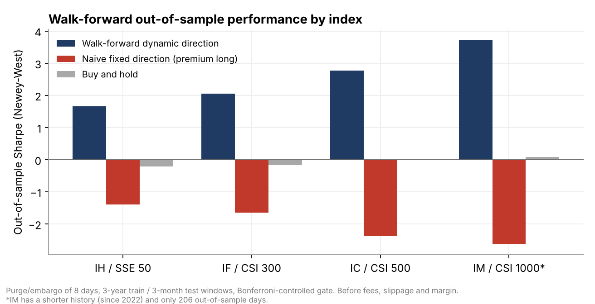
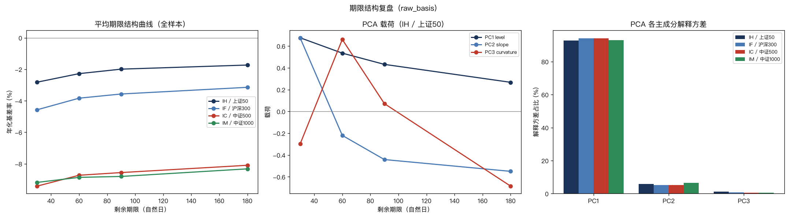
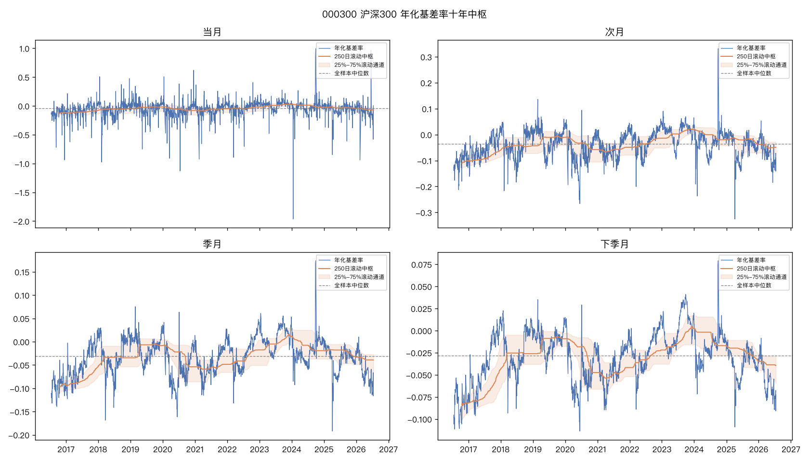

<h1 align="center">Basis Futures Strategy</h1>

<p align="center">
  <i>A research and backtest framework for CSI stock-index-futures basis that makes look-ahead bias impossible by construction.</i>
</p>

<p align="center">
  
  
  
  
  
</p>

---

## At a glance

| | |
|---|---|
| **Instruments** | IH / IF / IC / IM futures vs. 上证50 (000016) / 沪深300 (000300) / 中证500 (000905) / 中证1000 (000852) |
| **Data** | 10 years of daily data, with futures from CFFEX's official monthly ZIPs and spot indices from akshare |
| **Pipeline** | dividend adjustment → factor construction → walk-forward regression → position-series backtest → scenario forecast |
| **Validation** | Walk-forward (3-year train / 3-month test), 8-day purge and embargo, Newey-West (HAC) t-stats, Bonferroni-controlled selection gate |

> **Positioning:** this is a research and backtest tool, not an execution-ready trading system. All signals, forecasts and backtest returns come from historical data and simplified assumptions (no slippage, fees or margin constraints by default). Independent validation and risk review are required before any live use.

## Results

<p align="center"></p>

Out-of-sample results of the walk-forward dynamic-direction strategy, from a local run on raw basis data:

| Index | OOS days | Ann. return | Ann. vol | Sharpe (NW) | Max drawdown | Signal t (HAC) |
|---|---:|---:|---:|---:|---:|---:|
| IH / SSE 50 | 1,471 | 6.0% | 3.8% | 1.66 | −4.6% | 4.02 |
| IF / CSI 300 | 1,471 | 7.3% | 4.0% | 2.06 | −4.5% | 4.97 |
| IC / CSI 500 | 1,471 | 13.6% | 5.4% | 2.77 | −5.0% | 6.70 |
| IM / CSI 1000* | 206 | 15.5% | 6.3% | 3.73 | −1.5% | 3.36 |

<sub>*IM has a shorter history (listed in 2022), so its estimate rests on far fewer out-of-sample days. All figures are before fees, slippage and margin.</sub>

**What the comparison shows:** fixing the trade direction a priori (for example, "buy when the basis is at a deep premium") loses money out of sample on every index. Buy-and-hold is roughly flat. The value comes from **letting the direction be re-selected on training data only**, behind a pre-registered statistical gate.

<details>
<summary><b>Term-structure review: PCA shows a single level factor explains roughly 90% or more of the variance</b></summary>
<p align="center"></p>
</details>

<details>
<summary><b>Ten-year basis centre and rolling band for CSI 300</b></summary>
<p align="center"></p>
</details>

## Engineering disciplines (enforced in code, not just docs)

1. **Strict ordering:** strip dividends → build factors → regress → map to strategy → forecast. `run.py` calls the layers in exactly this order.
2. **No look-ahead:** `f2_future_return` / `y_convergence_rate` may only enter `regression.py`'s training matrix. `forecast.py`'s function signatures don't even accept these parameters, so a leak raises a `TypeError` instead of quietly inflating backtest numbers. `factors.assert_no_lookahead()` adds a defensive assertion, and `tests/test_regression_leakage.py` covers this.
3. **Hard/soft separation:** `forecast.forecast_basis()` always returns both `from_regression` (hard: pure statistical extrapolation, invariant to scenario assumptions) and `from_qualitative` (soft: behavioural overlay plus scenario assumption).
4. **Data-source isolation:** only `data.py` may `import akshare`. Every other module depends solely on the `DataAdapter` abstraction and the standard panel schema, and `tests/test_data_source_isolation.py` statically scans imports to enforce this. Switching sources (for example, akshare → Wind) only touches the `name` argument of `data.get_adapter(name)`.

## Quick start

```bash
pip install -r requirements.txt
python -m basis_model.run
pytest tests/ -v
```

Futures prices are read from CFFEX's official monthly ZIPs, and spot index levels come from [akshare](https://github.com/akfamily/akshare) (free, public data). Everything is cached locally under `.basis_cache/` (gitignored), and no data files are bundled in this repo. Outputs are written to `output/` (gitignored; see `output/README.md` for the expected structure).

To use your own market data, see `input/local_data/README.md` and set `DATA_SOURCE_PRIMARY = "local"` in `basis_model/config.py`. To run the dividend-adjusted variant with point-in-time dividend, weight and price tables, see `input/local_dividend/README.md`.

## Project layout

```
basis_model/
  config.py                    # every tunable parameter (indices, N, dates, cost, data source)
  data.py                      # DataAdapter interface + mock/cffex_akshare/akshare/local/wind backends
  dividend.py                  # dividend-adjustment core identity
  factors.py                   # factor panel construction + no-look-ahead assertions
  regression.py                # walk-forward OLS with Newey-West (HAC) t-stats
  strategy.py                  # backtest_position_series() [primary] + backtest_naive_overlapping() [illustrative only] + hedge_cost_ladder()
  forecast.py                  # hard (regression) + soft (qualitative) basis forecast
  report.py                    # optional docx report (python-docx)
  run.py                       # end-to-end entry point, all 4 indices
  run_dividend_variants.py     # dividend-adjusted variant using local point-in-time tables
  compare_variants.py          # raw vs. dividend-adjusted reconciliation
  compare_signal_directions.py # fixed a-priori signal directions vs. buy-and-hold/flat
  walkforward_direction.py     # walk-forward dynamic direction selection (purge/embargo/HAC gate)
  validate_local_data.py       # validates input/local_data/ before switching to DATA_SOURCE_PRIMARY="local"
tests/                         # pytest suite (see SKILL.md for what each file covers)
input/
  local_data/README.md         # format spec for bring-your-own market data
  local_dividend/README.md     # format spec for point-in-time dividend/weight/price tables
output/README.md               # expected output structure (generated files are gitignored)
docs/                          # figures used in this README
```

## Data-source switching (akshare → Wind, etc.)

All sources implement the same `DataAdapter` interface (`load_futures` / `load_index` / `load_dividends`) and produce an identical panel schema. To add a source, register it in `data._ADAPTER_REGISTRY` and point `config.DATA_SOURCE_PRIMARY` at it; factors, regression, strategy, forecast and run need no changes. A `wind` adapter stub already exists in `data.py`, with detailed TODOs for anyone with a Wind terminal licence. `run.resolve_primary_adapter()` detects the stub and falls back to `DATA_SOURCE_FALLBACK` automatically.

## Tests

The suite covers expiry-date calculation, CFFEX ZIP parsing, the dividend-adjustment identity, look-ahead prevention, the divergence between the two backtest engines (and why it happens), data-source import isolation, and a regression test for a real bug (`MockAdapter` mislabelling expired contracts as "current month"). The full list is in [SKILL.md](SKILL.md).

## Use as a Claude Code skill

This repo also ships a `SKILL.md`, so it can be cloned into a Claude Code skills directory:

```bash
git clone https://github.com/Xiewy21/BasisFuturesStrategy ~/.claude/skills/basis-futures-strategy
```

## Methodology reference

The core idea is to decompose the basis into an annualised-carry term plus month-of-expiry dummies, re-estimate the loading walk-forward, and map the fitted coefficient into a position through pre-registered thresholds. This is the researcher's own reimplementation of standard sell-side basis-trading methodology. No proprietary report text, tables or vendor data are reproduced here.

## Disclaimer

Research code for educational and personal use. Not investment advice. No warranty on data correctness or backtest performance. See the "Known limitations" section of [SKILL.md](SKILL.md) for what this framework does *not* model (slippage, fees, margin, position limits, multi-contract concurrency).
